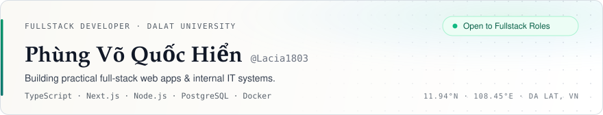

<a href="mailto:phungvoquochien.dev@gmail.com">
  <picture>
    <source media="(prefers-color-scheme: dark)" srcset="https://raw.githubusercontent.com/Lacia1803/Lacia1803/main/assets/banner-dark.svg?v=3" />
    <source media="(prefers-color-scheme: light)" srcset="https://raw.githubusercontent.com/Lacia1803/Lacia1803/main/assets/banner-light.svg?v=3" />
    
  </picture>
</a>

 

Final-year **Software Engineering** student at **Dalat University** (CTK46-PM), currently interning at the university's **IT Center** where I build and deploy IT Helpdesk and lab asset management systems. Focused on clean full-stack architecture, reliable Dockerized deployments, and maintainable code.

---

### Selected Projects

<table>
  <tr>
    <td width="50%" valign="top">
      <a href="https://github.com/Lacia1803/pinedesk"><strong>PineDesk</strong></a>&nbsp;&nbsp;<code>Team Lead</code>
       
      IT Helpdesk &amp; lab asset management platform for Dalat University — custom anti-abuse &amp; auth plugins, QR asset tagging, HTTPS reverse proxy, automated CI &amp; test harness.
        
      <code>GLPI 11</code> <code>PHP</code> <code>Python</code> <code>Nginx</code> <code>MariaDB</code> <code>Redis</code> <code>Docker</code>
    </td>
    <td width="50%" valign="top">
      <a href="https://github.com/Lacia1803/dlu-onedesk"><strong>DLU OneDesk</strong></a>&nbsp;&nbsp;<code>Full-stack</code>
       
      IT Helpdesk &amp; lab-equipment web app featuring 2FA authentication, AES-256-GCM encryption, Gemini API integration, and automated unit &amp; E2E tests.
        
      <code>Next.js 16</code> <code>React 19</code> <code>TypeScript</code> <code>Prisma</code> <code>PostgreSQL</code> <code>Docker</code>
    </td>
  </tr>
  <tr>
    <td width="50%" valign="top">
      <a href="https://github.com/Lacia1803/fittrack"><strong>FitTrack</strong></a>&nbsp;&nbsp;·&nbsp;&nbsp;<a href="https://fittrack-iota-three.vercel.app"><strong>Live Demo ↗</strong></a>
       
      Workout &amp; nutrition tracking PWA with per-set logging, progressive overload charts, Web Audio rest timer, and TDEE/macro calculation.
        
      <code>Next.js 16</code> <code>TypeScript</code> <code>Tailwind CSS</code> <code>Supabase</code> <code>Docker</code>
    </td>
    <td width="50%" valign="top">
      <a href="https://github.com/Lacia1803/DoAnWebNangCao"><strong>Library Management</strong></a>&nbsp;&nbsp;<code>Full-stack</code>
       
      Full-stack library platform with JWT RBAC, online document reader (PDF/DOCX), borrow tracking workflows, and analytics dashboard.
        
      <code>React</code> <code>Node.js</code> <code>Express</code> <code>Sequelize</code> <code>PostgreSQL</code> <code>Docker</code>
    </td>
  </tr>
</table>

> **Open Source & Tooling**
> - **[TsukiWeb](https://github.com/requinDr/tsukiweb-public/pull/138)** · [Live](https://tsukiweb.holofield.fr) — Contributed the full Vietnamese localization (`vi-lacia`) for *Tsukihime* & *PLUS-DISC* (442 scenes, 158k+ lines, custom script preprocessor & UI strings).
> - **[Ebook2LaTeX](https://github.com/Lacia1803/Ebook2LaTeX)** — Python CLI utility for converting ebooks into clean, structured LaTeX documents.

---

### Tech Stack

| Area | Technologies |
| :--- | :--- |
| **Languages** |       |
| **Frontend** |    |
| **Backend & Data** |        |
| **DevOps & Tools** |      |

---

### Contact

 

<i>“The curtain falls, but the dream goes on.”</i>
